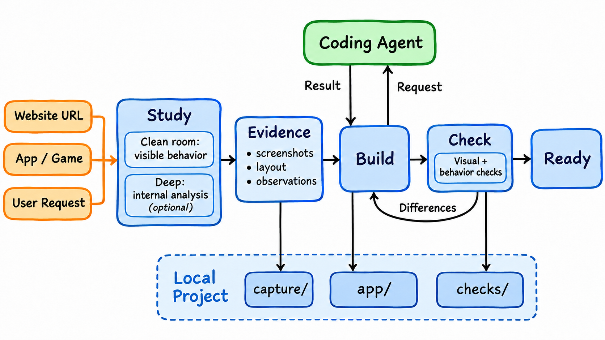
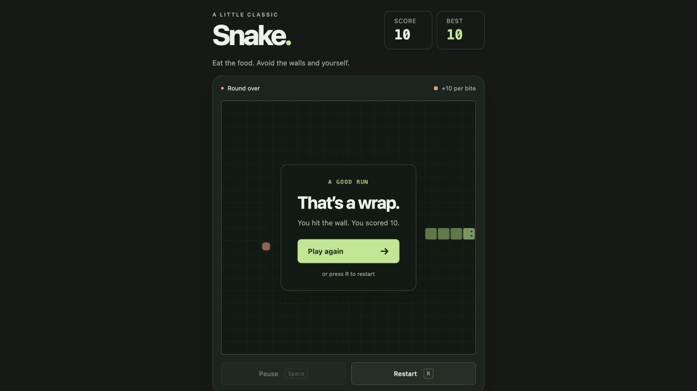

# 开源项目实测图文 · 作品示例

项目： [storytold/craft-anything](https://github.com/storytold/craft-anything)

成稿标题：**Craft Anything：把喜欢的网站和软件，做成自己的版本**。

## 请求与产物

从一个 GitHub 地址出发，制作包含基本介绍、部署与开始使用、实战与使用案例、结语的中文技术文章。

本次文章约 2,346 个汉字，8 张正文图片、3 张表格和 1 段安装代码。包含本机官方入门任务与 3 个外部使用案例，另交付黑体、宋体、文楷及两种公众号封面。这里选取三张有权公开的素材展示输出形式，不提供含第三方图片的完整文章包。

## 先写介绍，再做首图

> 好用的工具，总有几处想改。保留论坛的帖子列表，换成自己的兴趣社区；留下老软件的计算功能，做一个能在新电脑上运行的版本。
>
> Craft Anything 接收网站地址、应用或游戏文件，再根据你的要求重建项目。先观察原来的界面和行为，整理材料，交给编程代理实现，再运行检查。新项目和检查记录保存在本地，之后还能继续改。

标题保留读者想“做成自己的版本”的需求。论坛、旧工具、多个屏幕宽度和本地源码都来自介绍与核实资料；此图是概念插画。

## 用结构图解释机制

交代观察、材料、构建、检查之间的关系。箭头区分 Request 与 Result，本地目录对应 capture、app、checks。结构图是说明性概括，不表示所有自动检查在本次都成功。

## 展示实际运行结果

| 本机检查 | 结果 |
| --- | --- |
| 吃到第一颗食物 | 0→10 分，蛇身 3→4 格 |
| 空格暂停与恢复 | 暂停界面出现，恢复后继续移动 |
| 碰墙 | 本局结束，显示得分和重开入口 |
| 重开与刷新 | 本局 0 分，最高分仍为 10 |
| 纯规则自测 | 8 组检查通过 |

使用官方 v0.6.1 的贪吃蛇入门建议，指定 Plain HTML and CSS。本次原生重建流程最终未通过全部自动检查，截图检查未完成；上表来自独立浏览器操作与规则自测。没有把可玩的游戏写成整条自动流水线验收成功。

## 验证边界

这套工作流已经用于实际文章。公开版移除了作者本机路径、私人参考文章和个人二维码，并通过技能结构、目录、引用和公开内容检查；尚未在一台全新机器上完整重跑。

首图、架构图由内置图像工具生成，游戏截图来自实际运行。这里不包含第三方社区案例图片或原始账号、会话、系统日志。
